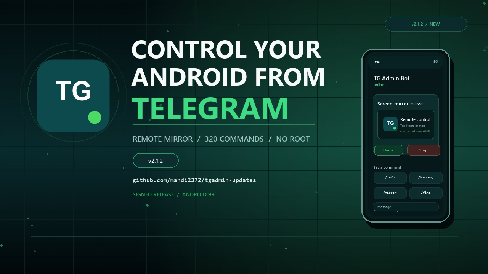

# TG Admin

**Telegram-controlled Android device administration with remote screen mirroring.**

[Download latest](https://github.com/mahdi2372/tgadmin-updates/releases/latest) · [Promo video](#promo-video) · [Verify the APK](#verify-the-download) · [Play Protect guidance](#play-protect-and-sideloading)


TG Admin is a private, self-hosted control panel for a single Android device. Commands are sent through a Telegram bot that you create and control. The app connects directly to the Telegram Bot API; there is no third-party relay server.

This repository hosts the signed APK releases and the auto-update feed.

## Promo video

[](https://mahdi2372.github.io/tgadmin-updates/video/)

A 60-second overview of TG Admin 2.1.2 with Bengali narration and English on-screen text. The phone UI shown is an illustrative mockup, not a real device capture.

[Play the video](https://mahdi2372.github.io/tgadmin-updates/video/) · [Download MP4](video/out/TGAdmin_YouTube_1080p.mp4) · [English subtitles](video/out/tgadmin_en.srt) · [Bengali subtitles](video/out/tgadmin_bn.srt)

## Latest release

| | |
|---|---|
| Version | **2.1.2** (versionCode 25) |
| Released | 2026-11-15 |
| Min Android | **Android 9+** for this signed build |
| APK size | 160,584 bytes |
| SHA-256 | `4B590C5792EE525F80CE317F13842298200739297A315E4013E4E22E84956E6B` |
| Signing cert SHA-256 | `308818e6b3ac52be332d3519cda69fd710837143c12a8e125baff3ea764e3382` |

Download:

- Stable name: [`TGAdmin.apk`](https://github.com/mahdi2372/tgadmin-updates/releases/latest/download/TGAdmin.apk)
- Pinned version: [`TGAdmin-v2.1.2.apk`](https://github.com/mahdi2372/tgadmin-updates/releases/download/v2.1.2/TGAdmin-v2.1.2.apk)

> The signed release uses APK Signature Scheme v3 only. Android 7/8 devices can remain on 2.1.0, or build and sign the app with v1/v2 signatures for older devices.

## What's new in 2.1.2

- **Hardened R8 release** — full-mode obfuscation, unused-code removal, resource shrinking, shortened resource paths, and source-file renaming.
- **Private release signing** — the active APK signer is a dedicated release key; v1/v2 debug signatures are removed.
- **In-place update support** — the signing certificate lineage preserves updates from the debug-signed 2.1.0 build on Android 9+.
- **Remote mirror reliability** — remote mode, automatic local/remote fallback, inline Home control, and `/stopmirror` are included from 2.1.0.
- **Clean release build** — `lintRelease` reports `No issues found.`

## Features

- Telegram bot control from your owner chat
- Remote screen mirroring through Telegram photos
- Local mirror mode over the same Wi-Fi network
- Automatic fallback to remote mode when Wi-Fi is unavailable
- Inline **Home** button on mirror messages
- Screen capture consent flow and foreground notification
- Device information, battery, network, storage, apps, calls, SMS, contacts, camera, location, and automation commands
- 320-command menu with aliases and categorized help
- No embedded bot token in release APKs; configure the bot on first launch

## Requirements

- Android 9 or newer for the signed 2.1.2 APK
- A Telegram bot created with [@BotFather](https://t.me/BotFather)
- Your numeric Telegram user ID
- Notification access, accessibility access, and screen-capture consent for the features you use
- Battery optimization disabled for reliable background operation

## Install or update

1. Download `TGAdmin.apk`.
2. Verify the SHA-256 and signing certificate using the steps below.
3. Install it. If 2.1.0 or 2.1.1 is already installed, install over it — do not uninstall first if you want to keep your token and settings.
4. Open the app and complete the bot setup.

For a manual install with ADB:

```powershell
adb install -r .\TGAdmin.apk
```

The app checks the latest GitHub release for updates. The stable update URL is:

```text
https://github.com/mahdi2372/tgadmin-updates/releases/latest/download/TGAdmin.apk
```

## Verify the download

PowerShell:

```powershell
Get-FileHash .\TGAdmin.apk -Algorithm SHA256
```

Expected:

```text
4B590C5792EE525F80CE317F13842298200739297A315E4013E4E22E84956E6B
```

Verify the signing certificate with Android SDK build-tools:

```powershell
apksigner verify --print-certs .\TGAdmin.apk
```

Expected certificate:

```text
Signer #1 certificate DN: CN=TG Admin Release, OU=Mobile, O=TG Admin, L=Dhaka, ST=Dhaka, C=BD
Signer #1 certificate SHA-256 digest: 308818e6b3ac52be332d3519cda69fd710837143c12a8e125baff3ea764e3382
```

Only install the APK if both the hash and signer match.

## Release signing

The private signing key and its password files are not distributed in this repository. Keep a secure offline backup: losing the key prevents future in-place updates.

Version 2.1.2 is signed with APK Signature Scheme v3. The signing lineage links it to the previous debug-signed 2.1.0 build so that existing installs on Android 9+ can update in place.

## Hardened build

The 2.1.2 APK is processed with R8 full mode: class, method, field, and package names are shortened; unused code is removed; resource paths are shortened; and unused resources are stripped. Android component classes are kept by name so notification-listener, accessibility, device-admin, and launcher registrations survive updates.

This is obfuscation, not encryption. An APK must be executable by Android, so a determined attacker can still reverse engineer it. No Android build can make decompilation impossible; hardening only raises the effort. The private R8 mapping file is not included in the APK or this repository.

## First-time setup

1. Create a bot with [@BotFather](https://t.me/BotFather) and copy its token.
2. Get your numeric Telegram user ID.
3. Open TG Admin, paste the bot token and owner ID, then save.
4. Start the bot and send `/start` from the owner chat.
5. Grant the permissions needed for your use case:
   - Notification access — notification commands
   - Accessibility service — screen, gestures, and remote control
   - Battery optimization exemption — reliable background operation
   - Screen capture consent — mirroring
   - Device administrator — optional lock/security actions

The bot only accepts commands from the configured owner chat.

## Remote mirror

| Command | What it does |
|---|---|
| `/mirror` | Starts mirroring; uses local mode when possible, otherwise remote mode |
| `/mirror remote` | Sends screen photos through Telegram; works over mobile data or Wi-Fi |
| `/mirror local` | Starts a local MJPEG link for the same Wi-Fi network |
| `/stopmirror` | Stops the mirror and foreground service |

Remote mode sends a refreshed photo to the same Telegram message. Local mode shares a short-lived MJPEG link and requires the phone and viewer to be on the same network. If Wi-Fi drops, the app can switch to remote mode automatically. Each new capture session may require screen-capture consent.

## Play Protect and sideloading

TG Admin is **not distributed through Google Play**, and it is not possible to guarantee that Play Protect will never show a warning for a sideloaded app.

Version 2.1.2 uses a private release key as the active signer and removes v1/v2 debug signatures. That removes one common reason Play Protect flags an APK. Play Protect may still warn or block apps that request sensitive capabilities such as SMS access, accessibility, notification access, device administration, screen capture, or app installation.

A warning is not proof that an APK is malicious, and a clean scan is not proof that it is safe. Treat any sideloaded automation app as powerful software:

- Verify the SHA-256 and signing certificate before installing.
- Download only from this repository.
- Do **not** disable Play Protect, bypass security prompts, or use workarounds to force an installation.
- If Play Protect blocks the app, do not install it on a device you do not control.
- If you believe the warning is a false positive, report the exact Play Protect message and app version rather than disabling protection.

No app can legitimately promise to suppress every Play Protect warning.

## Permissions and privacy

TG Admin needs powerful permissions because it is a remote device-administration tool. Permissions are requested only for features you enable.

| Group | Examples | Why |
|---|---|---|
| Network | Internet, Wi-Fi, nearby devices | Telegram connection and local mirror |
| Background | Foreground services, notifications, boot, wake lock, battery exemption | Keep commands and mirroring alive |
| Phone | Calls, phone state, call log, contacts | Call and contact commands |
| Messages | Read/send/receive SMS | SMS commands |
| Media | Camera, microphone, photos, files, screen capture | Camera, voice, file, and mirror commands |
| Device control | Accessibility, notification listener, device admin, settings, install packages | Screen control, notifications, and administration |
| Location | Fine/coarse/background location | Location commands |

Privacy notes:

- The bot token is stored on the device. Release APKs do not embed a token.
- The app connects to the Telegram Bot API and the update feed. There is no separate analytics or third-party relay backend.
- Anyone with the bot token can control the device. Keep it secret and revoke it with BotFather if it leaks.
- Use TG Admin only on a device you own and in compliance with local law.

## Troubleshooting

**Play Protect shows a warning or blocks installation**

Do not disable Play Protect. Verify the APK hash and signer first. If they match and you trust the build, follow the normal system prompt only if you accept the risk. If the app is blocked, report the exact message and version.

**"App not installed" on Android 7 or 8**

The 2.1.2 release APK uses APK Signature Scheme v3, which requires Android 9+. Remain on 2.1.0 or build and sign a v1/v2-compatible APK for older devices.

**Bot does not respond**

Check the bot token and owner ID, send `/start` from the owner chat, and make sure the bot has not been revoked. Regenerate the token with BotFather if needed.

**Mirror does not start**

Grant notification access, accessibility access, and screen-capture consent. Disable battery optimization for TG Admin, confirm the phone has network access, then send `/stopmirror` and try `/mirror` again.

**Update check fails**

Open the latest release page and download `TGAdmin.apk` manually. Verify the hash before installing.

## Release feed

- Latest: https://github.com/mahdi2372/tgadmin-updates/releases/latest
- Stable APK: https://github.com/mahdi2372/tgadmin-updates/releases/latest/download/TGAdmin.apk
- Repository: https://github.com/mahdi2372/tgadmin-updates

## Disclaimer

TG Admin is intended for personal use on devices you own. You are responsible for how you use it and for complying with applicable laws. The software is provided as-is, without warranty.

